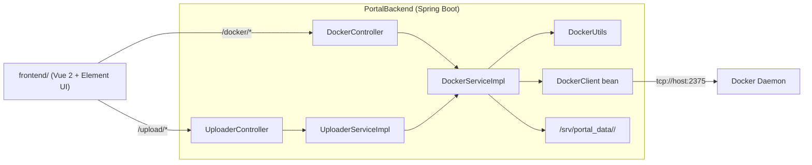

# Portal

A deployment portal for Docker: upload an application bundle (image tar + `config.yaml`) through the UI, and the Spring Boot backend loads the image into the Docker daemon, starts the containers, reports their status, and opens the deployed frontend URLs in an embedded monitoring view. The Vue 2 SPA lives in `frontend/`. Application and UI text is Chinese; this document is English.

Solo project on the [Seal-Re](https://github.com/Seal-Re) account. MIT licensed.

This is the Vue 2 / `vue-cli` generation of the portal. The Vue 3 + Vite rewrite is a separate repository, [DockerPortal](https://github.com/Seal-Re/DockerPortal): DockerPortal lists images and starts containers by hand, Portal manages whole named deployments driven by a config file, which DockerPortal has no equivalent of.

## What it does

1. `POST /upload/deployment` takes a tar archive of Docker images, a `config.yaml`, and a deployment name. The tar is stored under the deployment directory and loaded into Docker with `loadImageCmd`.
2. Every image listed in the config is re-tagged to `<deploymentName>_<originalName>` (lower-cased) and the original tag is removed, so several deployments can use the same base images without colliding.
3. The rewritten config (with prefixed image and service names) is saved as `<deploymentDir>/config.yaml`.
4. `POST /docker/start/{name}` reads that config and creates + starts one container per entry: port bindings, volume binds resolved relative to the deployment directory, and environment variables. Any container with the same name is stopped and removed first.
5. `GET /docker/status/{name}` returns container name/id/image/state plus host and container port, joined against the live container list.
6. `GET /docker/getUrlLists/{name}` returns the `frontend[].url` entries of the config, which the UI renders in iframes.
7. `POST /upload/delete/{name}` stops and removes the deployment's containers and images, then deletes the directory tree.

## Architecture



## API

| Method | Path | Description |
|---|---|---|
| `POST` | `/portal/upload/deployment` | Upload image tar + `config.yaml` + `name` (multipart) |
| `POST` | `/portal/upload/delete/{name}` | Stop/remove deployment Docker resources and delete its directory |
| `POST` | `/portal/docker/start/{name}` | Create and start every container in the deployment config |
| `POST` | `/portal/docker/stop/{deploymentName}` | Stop every container in the deployment config |
| `DELETE` | `/portal/docker/remove/{serviceName}` | Force-remove one container |
| `GET` | `/portal/docker/list` | List deployment directory names |
| `GET` | `/portal/docker/status/{deploymentName}` | `ContainerStatusDTO` list for the deployment |
| `GET` | `/portal/docker/getUrlLists/{deploymentName}` | Frontend URLs declared in the config |

Context path `/portal`, server port `43999` (`src/main/resources/application.yml`).

## `config.yaml` structure

Modelled by `ett/PortalConfig.java`:

```yaml
version: "1.0"
application_id: "demo"
images:
  - name: nginx:latest        # image name, must match the tar contents
    service_name: my-web      # container name
    description: "..."
    ports:
      - host: 8081            # host port
        container: 80         # container port
    volumes:                  # "relativeHostPath:containerPath"
      - "data:/usr/share/nginx/html"
    environment:
      KEY: value
    depends_on: []
frontend:
  - url: "http://host:8081"   # shown in the monitoring iframes
```

`depends_on` is parsed but never acted on: containers are created in list order, with no wait or readiness check between them.

## Frontend (`frontend/`)

Vue 2.6 + Element UI 2.15 + axios, two panels switched in `App.vue`:

- `DeploymentManager` — deployment list, expandable per-container status, upload dialog (tar + config + name), start / stop / remove / delete actions.
- `SystemMonitor` — picks a deployment, fetches its frontend URLs and renders each in an iframe (grid, click to maximise). Despite the name, these are application URLs from `config.yaml`; no host resource metrics are collected.

`vue.config.js` proxies `/docker` and `/upload` to `VUE_APP_BACKEND_URL` (default `http://192.168.1.97:43999`) and rewrites them under the `/portal` context path; `frontend/.env.example` holds the same variable. `frontend/nginx.conf` proxies to the same host in production.

## Tech stack

Backend: Java 11, Spring Boot 2.6.13, docker-java 3.2.13 (`docker-java-transport-httpclient5`, Apache HttpClient5), MyBatis-Plus 3.3.2 (declared but unused — there is no mapper or entity), Druid, MySQL Connector/J 8.0.28, Jackson YAML (a dedicated `yamlMapper` bean in `utils/JacksonConfig.java`), fastjson, Lombok.

Frontend: Vue 2.6, Element UI 2.15, axios, vue-cli 5 (Babel + ESLint).

## Getting started

```bash
# backend — fill in datasource credentials first
mvn spring-boot:run

# frontend
cd frontend && npm install && npm run serve     # vue-cli dev server on :8080
```

`application.yml` also configures a MySQL datasource, but no endpoint reads or writes the database — deployment state lives entirely in the file system and in Docker. A reachable Docker daemon is required:

```yaml
spring.datasource.url: jdbc:mysql://<host>:3306/<database>?serverTimezone=Asia/Shanghai
spring.datasource.username: <user>
spring.datasource.password: <password>

docker:
  client:
    host_linux: tcp://<host>:2375
    host_windows: npipe:////./pipe/docker_engine
    api-version: 1.41
```

`DockerConfig` selects `host_linux` or `host_windows` from `os.name`. Upload limits are set in the same file: `spring.servlet.multipart.max-file-size: 1000MB`, `max-request-size: 2000MB`, `server.tomcat.max-swallow-size: 2000MB`.

Deployment files are written to `/srv/portal_data/` on Linux and `~/PortalData/` on Windows (`utils/CommonConstants.java`), so the process needs write access there; the paths cannot be configured.

## Limitations

- No authentication or authorisation on any endpoint. The backend talks to the Docker daemon over an unencrypted TCP socket, so anyone who can reach the API has the backend's Docker privileges.
- Uploading a deployment leaves the original tag removed and image names prefixed; failed uploads are not rolled back.
- `depends_on` is ignored, so containers with startup dependencies may need manual restarts.
- No container logs, no restart/scale operations, single Docker host.
- The only test is the generated `PortalBackendApplicationTests` context-load stub; there is no CI configuration.

## License

MIT © [Seal-Re](https://github.com/Seal-Re)
